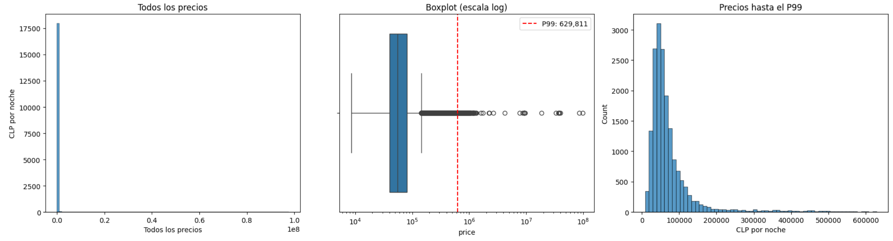
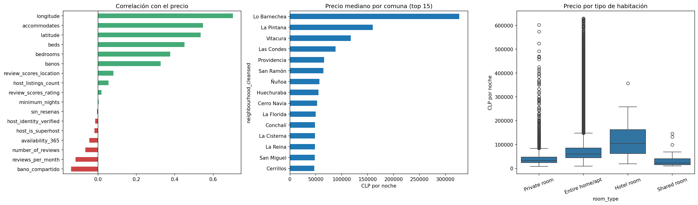
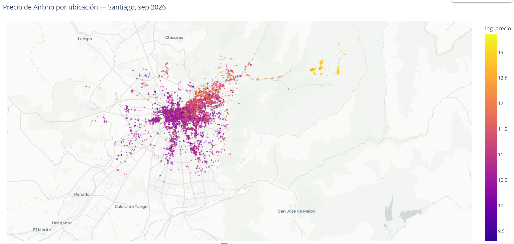
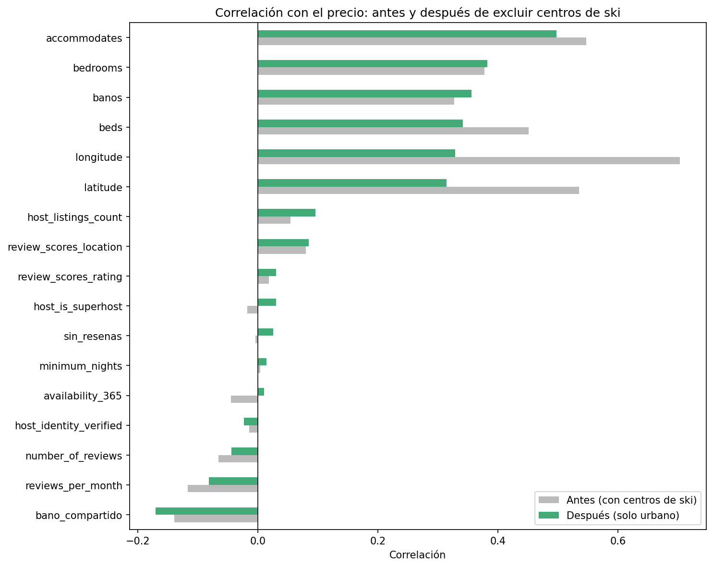

# Airbnb Santiago Price Prediction — ML Pipeline en AWS SageMaker

Proyecto end-to-end para entender el ciclo de vida completo de un modelo de Machine Learning en AWS: desde datos crudos hasta un modelo entrenado, automatizado y con demo pública.

**Autor:** Romell E. Avendaño

## Objetivo

Predecir el precio por noche de anuncios de Airbnb usando datos públicos de [Inside Airbnb](http://insideairbnb.com/get-the-data/), construyendo un pipeline reproducible en Amazon SageMaker.

**Datos:** Santiago de Chile, snapshot de septiembre 2026 (18.904 anuncios, precios en CLP)

## Principio rector: bajo costo

La prioridad del proyecto es **pilotear y entender cómo funciona el ciclo de ML en AWS con el mínimo costo posible**.

- **Primero Colab, después AWS:** toda exploración, limpieza y prueba de código se hace en Google Colab (gratis). Solo lo que ya está testeado pasa a AWS.
- **AWS solo para lo que se demuestra:** S3, Processing, Training y Pipelines se usan para ejecutar código probado, no para experimentar.
- **Capa gratuita primero:** instancias pequeñas (`ml.t3.medium`, `ml.m5.large`) dentro del Free Tier de SageMaker.
- **Nada encendido sin uso:** notebooks detenidos y endpoints borrados al terminar cada sesión. Sin ejecuciones programadas.
- **Alerta de presupuesto** en AWS Budgets antes de crear cualquier recurso.
- **Demo fuera de AWS:** Hugging Face Spaces, sin costo mensual.
- **Costo medido y documentado:** el gasto real se registra con capturas de Cost Explorer como parte del resultado.

## Dataset original

| | |
|---|---|
| **Fuente** | [Inside Airbnb](http://insideairbnb.com/get-the-data/), archivo `listings.csv.gz` (versión detallada) |
| **Ciudad** | Santiago de Chile |
| **Snapshot** | Septiembre 2026 (último scraping: 26-09-2026) |
| **Tamaño** | 10,7 MB comprimido |
| **Filas** | **18.904** anuncios |
| **Columnas** | **90** (37 decimales, 24 enteras, 29 de texto) |
| **Variable objetivo** | `price`, precio por noche en pesos chilenos (CLP), en formato texto (`"$59,303.00"`) |

**Qué contiene, por grupo de columnas:**

| Grupo | Columnas | Ejemplos |
|-------|---------:|----------|
| Anfitrión | 28 | superanfitrión, identidad verificada, cantidad de anuncios |
| Disponibilidad y noches | 16 | días disponibles al año, noches mínimas y máximas |
| Reseñas | 14 | número de reseñas, puntajes, reseñas por mes |
| Precio e ingresos | 7 | precio por noche, cotizaciones, ingreso estimado |
| Propiedad, ubicación y otros | 25 | tipo de habitación, capacidad, dormitorios, comuna, coordenadas, URLs |

**Estado de calidad al recibirlo:**
- 14 columnas vienen **100 % vacías** (p. ej. `bathrooms`, `host_since`, `instant_bookable`).
- 17 columnas tienen **más de 50 % de nulos**; solo 44 están completas.
- El 4,8 % de los anuncios **no tiene precio**, y hay precios de hasta **97,5 millones CLP/noche**.

Tras la limpieza quedaron **17.256 anuncios y 21 columnas** (91 % de los anuncios). Ver [hallazgos del EDA](docs/hallazgos_eda.md).

## Práctica: registro de decisiones

Toda decisión relevante del proyecto (limpieza de datos, elección de variables, modelo, arquitectura, costos) se documenta en [docs/decisiones.md](docs/decisiones.md) con su fecha y su justificación. Los resultados de cada entrenamiento se registran en [docs/experimentos.md](docs/experimentos.md).

## Arquitectura

```
Inside Airbnb (CSV)
      │
      ▼
 Amazon S3 (raw/)
      │
      ▼
 Processing step (preprocess.py) ──► S3 (processed/)
      │
      ▼
 Training step (XGBoost integrado) ──► S3 (output/)
      │
      ▼
 Evaluation + Model Registry
      │
      ▼
 Inferencia (batch transform / serverless)
      │
      ▼
 Demo pública en Hugging Face Spaces (Gradio)
```

## Stack

- **Exploración:** Google Colab, pandas, matplotlib, seaborn
- **Almacenamiento:** Amazon S3
- **Entrenamiento y orquestación:** Amazon SageMaker (Studio, Processing, Training, Pipelines)
- **Modelo:** XGBoost
- **Demo:** Hugging Face Spaces + Gradio

## Estructura del repositorio

```
├── data/          # Datos locales (no se suben a Git)
├── notebooks/     # Notebook de Colab (EDA, limpieza, modelos) y ejecución en SageMaker
├── src/           # Scripts: preprocess.py, pipeline, etc.
├── docs/          # Diagramas y registro de decisiones
├── images/        # Capturas de AWS
├── PLAN.md        # Plan de trabajo
└── requirements.txt
```

## Estado

🚧 En desarrollo — ver [PLAN.md](PLAN.md)

## Hallazgos del análisis exploratorio

- La **capacidad** (`accommodates`) y la **ubicación** son las variables más relacionadas con el precio.
- El oriente de Santiago (Vitacura, Las Condes, Providencia) es más caro; el sur y el poniente, más baratos.
- Se detectaron y excluyeron los **centros de ski** de la cordillera: un mercado distinto que inflaba artificialmente la relación entre longitud y precio (correlación de 0,70 a 0,33).
- Se conservó el 91 % de los anuncios tras la limpieza (17.256 de 18.904).

Detalle completo: [docs/hallazgos_eda.md](docs/hallazgos_eda.md)

### Evidencia visual

**1. Precios crudos.** Unos pocos valores de hasta 97 millones CLP/noche aplastan la escala; el boxplot logarítmico marca el corte en el percentil 99.



**2. Precios después de la limpieza.** Distribución con cola larga hacia la derecha; en escala logarítmica es casi simétrica.


**3. Relación con el precio (antes de excluir los centros de ski).** Correlaciones, precio mediano por comuna y por tipo de habitación.



**4. Ubicación de los anuncios.** La forma de Santiago aparece dibujada por los propios anuncios.


**5. Mapa antes de excluir los centros de ski.** Arriba a la derecha, el grupo amarillo de Farellones, La Parva y Valle Nevado.



**6. Mapa después: solo Santiago urbano.**


**7. Efecto en la correlación.** Al excluir los centros de ski, la longitud baja de 0,70 a 0,33 y las variables de la propiedad (capacidad, dormitorios, baños) pasan a encabezar la lista.



## Resultados

Cada versión del modelo y sus métricas se registra en [docs/experimentos.md](docs/experimentos.md). Modelo final de Colab (v5): **MAE 12.917 CLP, RMSE 25.725 CLP, R² 0,678**.

_Por completar: comparación Colab vs SageMaker._

## Costo real en AWS

_Por completar: captura de Cost Explorer y desglose._

## Aprendizajes

_Por completar._

## Cómo reproducirlo

_Por completar._
