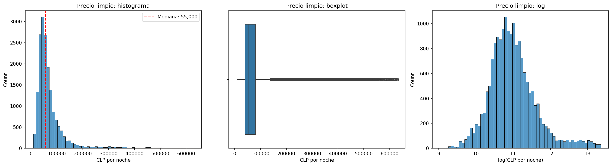
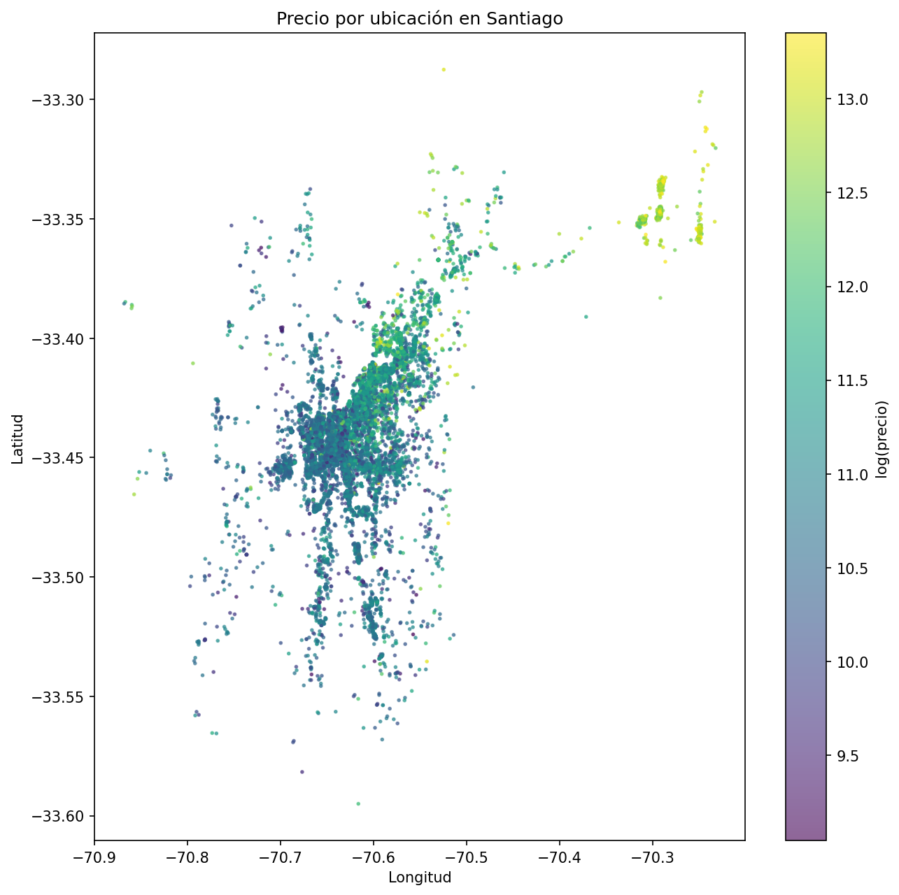

# Airbnb Santiago Price Prediction - Análisis de datos y modelo XGBoost

Proyecto de Machine Learning para predecir el precio por noche de los anuncios de Airbnb en Santiago de Chile: Desde los datos crudos hasta un modelo XGBoost entrenado y evaluado en Google Colab.

**Autor:** Romell E. Avendaño

[](https://colab.research.google.com/github/xavendano/airbnb-santiago-sagemaker-pipeline/blob/main/notebooks/airbnb_santiago_sagemaker_pipeline.ipynb)

## Objetivo

Predecir el precio por noche de anuncios de Airbnb usando datos públicos de [Inside Airbnb](https://insideairbnb.com/get-the-data/), con un análisis exploratorio documentado, una limpieza reproducible y un modelo evaluado contra una referencia simple.

**Datos:** Santiago de Chile, snapshot de septiembre 2026 (18.904 anuncios, precios en CLP)

## Estado

✅ **Cerrado.** El repositorio cubre el análisis exploratorio, la limpieza y el entrenamiento del modelo en Google Colab. El despliegue en AWS SageMaker queda como [próxima etapa](#próxima-etapa-despliegue-en-sagemaker) y se explicará en otra plataforma, todavía por definir.

## Principio rector: Bajo costo

Todo el trabajo de este repositorio se hizo en **Google Colab** (gratis): Exploración, limpieza, entrenamiento y ajuste del modelo. La idea es que a AWS solo pase código ya probado, para pagar únicamente por lo que se demuestra.

## Dataset original

|                       |                                                                                                        |
| --------------------- | ------------------------------------------------------------------------------------------------------ |
| **Fuente**            | [Inside Airbnb](https://insideairbnb.com/get-the-data/), archivo `listings.csv.gz` (versión detallada) |
| **Ciudad**            | Santiago de Chile                                                                                      |
| **Snapshot**          | Septiembre 2026 (último scraping: 26-09-2026)                                                          |
| **Tamaño**            | 10,7 MB comprimido                                                                                     |
| **Filas**             | **18.904** anuncios                                                                                    |
| **Columnas**          | **90** (37 decimales, 24 enteras, 29 de texto)                                                         |
| **Variable objetivo** | `price`, precio por noche en pesos chilenos (CLP), en formato texto (`"$59,303.00"`)                   |

**¿Qué contiene cada grupo de columnas?**

| Grupo                        | Columnas | Ejemplos                                                              |
| ---------------------------- | -------: | --------------------------------------------------------------------- |
| Anfitrión                    |       28 | Superanfitrión, identidad verificada, cantidad de anuncios            |
| Disponibilidad y noches      |       16 | Días disponibles al año, noches mínimas y máximas                     |
| Reseñas                      |       14 | Número de reseñas, puntajes, reseñas por mes                          |
| Precio e ingresos            |        7 | Precio por noche, cotizaciones, ingreso estimado                      |
| Propiedad, ubicación y otros |       25 | Tipo de habitación, capacidad, dormitorios, comuna, coordenadas, URLs |

**Estado de calidad al recibirlo:**

- 14 columnas vienen **100 % vacías** (p. ej. `bathrooms`, `host_since`, `instant_bookable`).
- 17 columnas tienen **más de 50 % de nulos**; solo 44 están completas.
- El 4,8 % de los anuncios **no tiene precio**, y hay precios de hasta **97,5 millones CLP/noche**.

**De los datos crudos al modelo:**

| Etapa                    | Anuncios | ¿Qué se quitó?                                                                                                   |
| ------------------------ | -------: | ---------------------------------------------------------------------------------------------------------------- |
| Datos crudos             |   18.904 | -                                                                                                                |
| Tras la limpieza del EDA |   17.256 | Anuncios sin precio, outliers sobre el percentil 99 y centros de ski                                             |
| Datos del modelo final   |   17.178 | 78 precios sospechosos (habitaciones sobre 150 mil CLP/noche y unidades completas sobre 150 mil CLP por huésped) |

El filtro de precios sospechosos se aplica solo al entrenar; en un anuncio nuevo no hay precio que filtrar. Ver [hallazgos del EDA](docs/hallazgos_eda.md) y [registro de decisiones](docs/decisiones.md).

## Práctica: Registro de decisiones

Toda decisión relevante del proyecto (limpieza de datos, elección de variables, modelo) se documenta en [docs/decisiones.md](docs/decisiones.md) con su fecha y su justificación. Los resultados de cada entrenamiento se registran en [docs/experimentos.md](docs/experimentos.md).

## Stack

- **Entorno:** Google Colab + Google Drive
- **Datos y gráficos:** pandas, numpy, matplotlib, seaborn, plotly
- **Modelo y evaluación:** XGBoost (`XGBRegressor`), scikit-learn (split, validación cruzada y métricas)

## Estructura del repositorio

```
├── data/
│   ├── README.md                       # Fuente y fecha del snapshot
│   └── raw/                            # listings.csv.gz (no se sube a Git)
├── notebooks/
│   └── airbnb_santiago_sagemaker_pipeline.ipynb   # EDA, limpieza y modelos v1-v6
├── src/
│   └── bloque_sospechosos_premium.py   # Filtro de precios sospechosos y variables premium
├── docs/
│   ├── hallazgos_eda.md                # Hallazgos del análisis exploratorio
│   ├── decisiones.md                   # Registro de decisiones
│   └── experimentos.md                 # Registro de experimentos (v1-v6)
├── images/eda/                         # Gráficos del EDA
├── PLAN.md                             # Plan de trabajo
└── requirements.txt
```

## Hallazgos del análisis exploratorio

- La **capacidad** (`accommodates`) y la **ubicación** son las variables más relacionadas con el precio.
- El oriente de Santiago (Vitacura, Las Condes, Providencia) es más caro; el sur y el poniente, más baratos.
- Se detectaron y excluyeron los **centros de ski** de la cordillera: Un mercado distinto que inflaba artificialmente la relación entre longitud y precio (correlación de 0,70 a 0,33).
- Se conservó el 91 % de los anuncios tras la limpieza (17.256 de 18.904).

Detalle completo: [docs/hallazgos_eda.md](docs/hallazgos_eda.md)

### Evidencia visual

**1. Precios crudos.** Unos pocos valores de hasta 97 millones CLP/noche aplastan la escala; el boxplot logarítmico marca el corte en el percentil 99.


**2. Precios después de la limpieza.** Distribución con cola larga hacia la derecha; en escala logarítmica es casi simétrica.



**3. Relación con el precio (antes de excluir los centros de ski).** Correlaciones, precio mediano por comuna y por tipo de habitación.


**4. Ubicación de los anuncios.** La forma de Santiago aparece dibujada por los propios anuncios.



**5. Mapa antes de excluir los centros de ski.** Arriba a la derecha, el grupo amarillo de Farellones, La Parva y Valle Nevado.


**6. Mapa después: Solo Santiago urbano.**


**7. Efecto en la correlación.** Al excluir los centros de ski, la longitud baja de 0,70 a 0,33 y las variables de la propiedad (capacidad, dormitorios, baños) pasan a encabezar la lista.


## Variables del modelo

El modelo final parte de las **18 variables elegidas en el EDA** y suma **11 variables premium**. Tras las conversiones y el one-hot encoding quedan **71 columnas**.

**Variables base** (las 18 del EDA, ya convertidas):

| Grupo          | Variables                                                                                                 |
| -------------- | --------------------------------------------------------------------------------------------------------- |
| Propiedad      | `room_type`, `property_type`, `accommodates`, `bedrooms`, `beds`, `banos`, `bano_compartido`              |
| Ubicación      | `neighbourhood_cleansed`, `latitude`, `longitude`                                                         |
| Anfitrión      | `host_is_superhost`, `host_listings_count`, `host_identity_verified`                                      |
| Reseñas        | `number_of_reviews`, `review_scores_rating`, `review_scores_location`, `reviews_per_month`, `sin_resenas` |
| Disponibilidad | `minimum_nights`, `availability_365`                                                                      |

`banos` y `bano_compartido` salen de `bathrooms_text`, y `sin_resenas` es un indicador agregado para los anuncios sin reseñas.

**11 variables premium**, agregadas porque el modelo base subestimaba las unidades caras de Las Condes y Vitacura:

- `n_amenities` y 7 indicadores desde `amenities`: `tiene_estacionamiento`, `tiene_aire`, `tiene_piscina`, `tiene_jacuzzi`, `tiene_gimnasio`, `tiene_lavavajillas`, `tiene_calefaccion`
- `dist_el_golf_km`: Distancia al barrio El Golf (Las Condes)
- `titulo_premium`: El título dice lujo, luxury, premium o exclusivo
- `calculated_host_listings_count_entire_homes`: Anfitrión profesional

**Categóricas (one-hot):** `room_type`; `property_type`, con las categorías de menos de 50 anuncios agrupadas en "Otro"; y `neighbourhood_cleansed`, con las comunas de menos de 30 anuncios agrupadas en "Otra comuna".

Ninguna variable se calcula a partir del precio, para evitar data leakage. Detalle en [docs/decisiones.md](docs/decisiones.md).

## Resultados

El modelo predice `log1p(price)` y las métricas se calculan en CLP sobre un 20 % de prueba que no se usa para entrenar ni para ajustar.

| Versión            | Cambio principal                                          |  MAE (CLP) | RMSE (CLP) |        R² |
| ------------------ | --------------------------------------------------------- | ---------: | ---------: | --------: |
| Referencia ingenua | Predecir siempre la mediana                               |     27.215 |          - |         - |
| v1                 | Modelo base: 18 variables + one-hot                       |     14.533 |     30.201 |     0,595 |
| v2                 | + Filtro de precios sospechosos y 11 variables premium    |     13.109 |     25.915 |     0,673 |
| v3                 | Ajuste de hiperparámetros con validación cruzada          |     13.017 |     25.842 |     0,675 |
| v4                 | `learning_rate` 0,02 + early stopping                     |     12.958 |     25.768 |     0,677 |
| **v5**             | **`learning_rate` 0,01 + early stopping (3.328 árboles)** | **12.917** | **25.725** | **0,678** |

**Modelo final: v5.** Su error medio es menos de la mitad que el de predecir siempre la mediana. La v6 (árboles más profundos) empató con la v5 en el test y se descartó por ser más compleja.

**¿Qué movió la mejora?**

- La mayor ganancia vino de **los datos**: El filtro de precios sospechosos explica la mayor parte del salto de v1 a v2, y las variables premium aportan cerca de un 3 % adicional de MAE.
- Los **hiperparámetros** (v3 a v6) mejoraron el MAE menos de 1 % en total.
- El error se concentra en los anuncios más caros, que son los más difíciles de predecir.

> La referencia ingenua de v1 es 27.794 CLP; desde v2 es 27.215 porque el test ya no incluye los precios sospechosos. Detalle de todas las versiones, hiperparámetros y notas en [docs/experimentos.md](docs/experimentos.md).

## Aprendizajes

- **Los datos pesan más que el modelo.** Limpiar precios imposibles y agregar variables con sentido de negocio mejoró mucho más que ajustar hiperparámetros.
- **Mirar el mapa antes de confiar en una correlación.** La longitud parecía muy relacionada con el precio (0,70), pero era el efecto de los centros de ski de la cordillera, otro mercado. Al excluirlos bajó a 0,33.
- **Revisar los peores errores del modelo** llevó a encontrar anuncios con precios de relleno (habitaciones a 300-600 mil CLP, la mayoría sin reseñas y disponibles casi todo el año).
- **Comparar siempre contra una referencia simple** (la mediana) y sobre el mismo conjunto de prueba, para saber cuánto aporta de verdad cada cambio.
- **Registrar cada decisión y cada experimento** en el momento hace que el proyecto se pueda explicar y repetir después.

## ¿Cómo reproducirlo?

[](https://colab.research.google.com/github/xavendano/airbnb-santiago-sagemaker-pipeline/blob/main/notebooks/airbnb_santiago_sagemaker_pipeline.ipynb)

1. Abre el notebook en Google Colab con el botón de arriba. Colab lo carga directo desde GitHub.
2. Guarda una copia en tu propio Drive (Archivo > Guardar una copia en Drive). Así puedes ejecutarlo y guardar cambios sin tocar el original.
3. Descarga `listings.csv.gz` de Santiago desde [Inside Airbnb](https://insideairbnb.com/get-the-data/) (versión detallada). Ver [data/README.md](data/README.md).
4. Sube el archivo a tu Google Drive, en `MyDrive/Colab Notebooks/airbnb-santiago-sagemaker-pipeline/`. El notebook lee los datos y guarda imágenes y modelos en esa carpeta; si usas otra, cambia la variable `path` al inicio del notebook.
5. En tu copia, autoriza el acceso a Drive cuando el notebook lo pida y ejecuta las celdas en orden.

**Fuera de Colab:** Clona el repositorio, instala las dependencias y reemplaza el montaje de Drive por una ruta local:

```bash
git clone https://github.com/xavendano/airbnb-santiago-sagemaker-pipeline.git
pip install -r requirements.txt
```

> Inside Airbnb publica snapshots nuevos cada pocos meses. Con otro snapshot las cifras van a variar un poco respecto de las de este README.

## Créditos y licencia de los datos

Los datos provienen de [Inside Airbnb](https://insideairbnb.com/), que los publica bajo la licencia [Creative Commons Attribution 4.0 International (CC BY 4.0)](https://creativecommons.org/licenses/by/4.0/). Este proyecto no está afiliado a Airbnb ni a Inside Airbnb.

## Próxima etapa: Despliegue en SageMaker

El siguiente paso es llevar el modelo v5 a **Amazon SageMaker** como un pipeline reproducible. Esta etapa se explicará en otra plataforma, todavía por definir, y no forma parte de este repositorio.

**Arquitectura prevista:**

```
Inside Airbnb (CSV)
      │
      ▼
 Amazon S3 (raw/)
      │
      ▼
 Processing step (preprocess.py) ──► S3 (processed/)
      │
      ▼
 Training step (XGBoost integrado) ──► S3 (output/)
      │
      ▼
 Evaluation + Model Registry
      │
      ▼
 Inferencia (batch transform / serverless)
      │
      ▼
 Demo pública (plataforma por definir)
```

**Stack previsto:** Amazon S3, Amazon SageMaker (Studio, Processing, Training, Pipelines) y una demo pública (plataforma por definir).

**Criterios de bajo costo para esa etapa:**

- **AWS solo para lo que se demuestra:** S3, Processing, Training y Pipelines se usan para ejecutar código ya probado en Colab, no para experimentar.
- **Capa gratuita primero:** Instancias pequeñas (`ml.t3.medium`, `ml.m5.large`) dentro del Free Tier de SageMaker.
- **Nada encendido sin uso:** Notebooks detenidos y endpoints borrados al terminar cada sesión. Sin ejecuciones programadas.
- **Alerta de presupuesto** en AWS Budgets antes de crear cualquier recurso.
- **Demo fuera de AWS:** Demo pública en una plataforma por definir, sin costo mensual.
- **Costo medido y documentado** con capturas de Cost Explorer.

**¿Qué se va a mostrar en esa etapa?** La comparación de métricas entre Colab y SageMaker para el mismo modelo v5, y el costo real en AWS.
