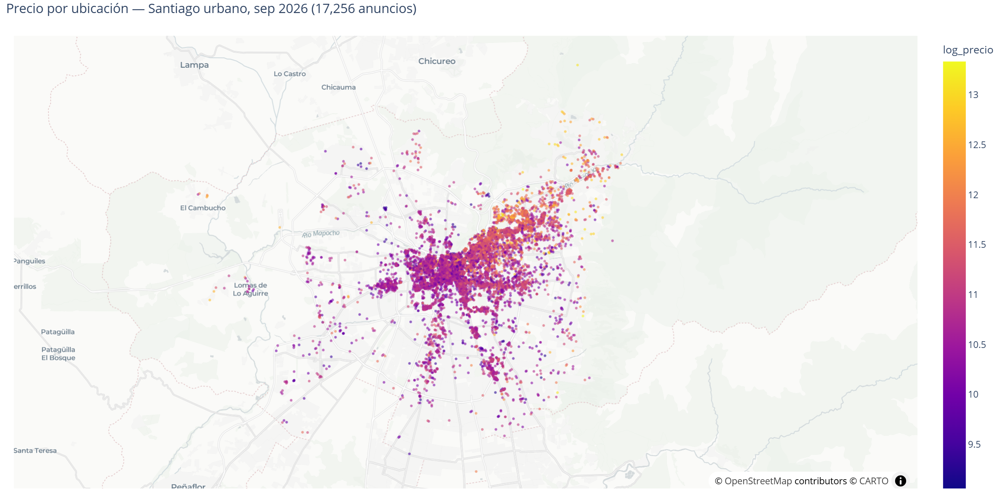

# Airbnb Price Prediction — ML Pipeline en AWS SageMaker

Proyecto end-to-end para entender el ciclo de vida completo de un modelo de Machine Learning en AWS: desde datos crudos hasta un modelo entrenado, automatizado y con demo pública.

**Autor:** Romell E. Avendaño

## Objetivo

Predecir el precio por noche de anuncios de Airbnb usando datos públicos de [Inside Airbnb](http://insideairbnb.com/get-the-data/), construyendo un pipeline reproducible en Amazon SageMaker.

**Datos:** Santiago de Chile, snapshot de septiembre 2026 (18.904 anuncios, precios en CLP)

## Principio rector: bajo costo

La prioridad del proyecto es **pilotear y entender cómo funciona el ciclo de ML en AWS con el mínimo costo posible**.

- **Primero Colab, después AWS:** toda exploración, limpieza y prueba de código se hace en Google Colab (gratis). Solo lo que ya está testeado pasa a AWS.
- **AWS solo para lo que se demuestra:** S3, Processing, Training y Pipelines se usan para ejecutar código probado, no para experimentar.
- **Capa gratuita primero:** instancias pequeñas (`ml.t3.medium`, `ml.m5.large`) dentro del Free Tier de SageMaker.
- **Nada encendido sin uso:** notebooks detenidos y endpoints borrados al terminar cada sesión. Sin ejecuciones programadas.
- **Alerta de presupuesto** en AWS Budgets antes de crear cualquier recurso.
- **Demo fuera de AWS:** Hugging Face Spaces, sin costo mensual.
- **Costo medido y documentado:** el gasto real se registra con capturas de Cost Explorer como parte del resultado.

## Práctica: registro de decisiones

Toda decisión relevante del proyecto (limpieza de datos, elección de variables, modelo, arquitectura, costos) se documenta en [docs/decisiones.md](docs/decisiones.md) con su fecha y su justificación.

## Arquitectura

```
Inside Airbnb (CSV)
      │
      ▼
 Amazon S3 (raw/)
      │
      ▼
 Processing step (preprocess.py) ──► S3 (processed/)
      │
      ▼
 Training step (XGBoost integrado) ──► S3 (output/)
      │
      ▼
 Evaluation + Model Registry
      │
      ▼
 Inferencia (batch transform / serverless)
      │
      ▼
 Demo pública en Hugging Face Spaces (Gradio)
```

## Stack

- **Exploración:** Google Colab, pandas, matplotlib, seaborn
- **Almacenamiento:** Amazon S3
- **Entrenamiento y orquestación:** Amazon SageMaker (Studio, Processing, Training, Pipelines)
- **Modelo:** XGBoost
- **Demo:** Hugging Face Spaces + Gradio

## Estructura del repositorio

```
├── data/          # Datos locales (no se suben a Git)
├── notebooks/     # Exploración (Colab) y ejecución en SageMaker
├── src/           # Scripts: preprocess.py, pipeline, etc.
├── docs/          # Diagramas y registro de decisiones
├── images/        # Capturas de AWS
├── PLAN.md        # Plan de trabajo
└── requirements.txt
```

## Estado

🚧 En desarrollo — ver [PLAN.md](PLAN.md)

## Hallazgos del análisis exploratorio

- La **capacidad** (`accommodates`) y la **ubicación** son las variables más relacionadas con el precio.
- El oriente de Santiago (Vitacura, Las Condes, Providencia) es más caro; el sur y el poniente, más baratos.
- Se detectaron y excluyeron los **centros de ski** de la cordillera: un mercado distinto que inflaba artificialmente la relación entre longitud y precio (correlación de 0,70 a 0,33).
- Se conservó el 91 % de los anuncios tras la limpieza (17.256 de 18.904).

Detalle completo: [docs/hallazgos_eda.md](docs/hallazgos_eda.md)



## Resultados

_Por completar: métricas (RMSE, MAE), comparación Colab vs SageMaker._

## Costo real en AWS

_Por completar: captura de Cost Explorer y desglose._

## Aprendizajes

_Por completar._

## Cómo reproducirlo

_Por completar._
